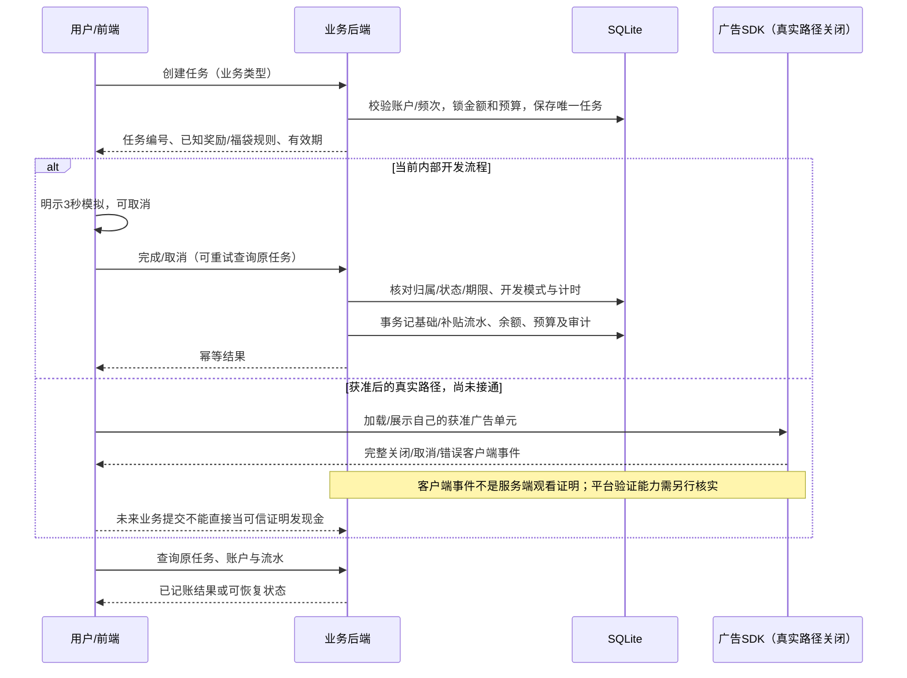

# v0.4.0交付与验收记录

验收日期：2026-10-25（北京时间）。分支：`codex/yuanxiang-v1-review`。入口见[明早审核清单](明早审核清单.md)，安装见[部署与维护](部署与维护-v0.4.md)。本次交付为内部审核版；开发模拟、官方技术能力与商业场景许可分别记录。

## 产品范围

主线为签到、聊天式红包群、宝箱、福袋、金币和补贴；后台管理不同昵称/原创头像的活动助手及定时消息。助手明确标注，不冒充真实群友，不使用伪造提现宣传。红包金额来自实际个人奖励池预留，消息不能创造余额；关闭暂存、取消保留、完成入账。

新增账户管理、分页记录、JSON导出、会话撤销、注销审核、用户搜索、日经营报表、人工账单与冲销、内部账务核对，以及部署和备份工具。保留旧分支与本机配置，不把演示金币迁成真实现金权益。

## 规则与能力核实

以下官方入口于2026-10-25（北京时间）重新请求。微信官网连接返回`Tunnel connection failed: 403 Forbidden`，没有取得当前有效规则正文；这是访问限制，不是对产品的许可或拒绝结论。

| 核实项 | 官方资料 | 当前结论与实施门槛 |
|---|---|---|
| 主体、类目、主营业务及营销行为 | [微信小程序产品资料](https://developers.weixin.qq.com/miniprogram/product/) | 未核实。纯广告奖励主体、签到、叠包、随机奖励及邀请须按完整真实场景取得适用依据。 |
| 流量主准入及广告奖励范围 | [微信广告](https://ad.weixin.qq.com/)、[激励视频接入](https://developers.weixin.qq.com/miniprogram/dev/framework/open-ability/ad/rewarded-video-ad.html) | 未核实。现金、实物、话费等均不推定许可；没有开放真实广告任务。 |
| 展示位置、刷新与频控 | [广告组件](https://developers.weixin.qq.com/miniprogram/dev/component/ad.html)、[插屏](https://developers.weixin.qq.com/miniprogram/dev/framework/open-ability/ad/interstitial-ad.html) | 官网正文未核实。15/45秒等只是开发预览参数，不是平台允许频次；不自动展示插屏。 |
| 隐私与投诉要求 | [微信隐私资料入口](https://developers.weixin.qq.com/miniprogram/dev/framework/user-privacy/) | 当前规则正文未核实。现有最小化采集、导出、客服、注销为工程措施，正式主体声明、期限与权利处理仍须完善。 |
| 微信零钱提现 | [微信支付](https://pay.weixin.qq.com/) | 场景及权限未核实。商户号不等于商家转账获准；支付适配器、通知验签、查单和渠道对账未接入。 |
| 激励视频客户端SDK | [官方类型定义：创建组件](https://github.com/wechat-miniprogram/api-typings/blob/6092df9100c73b84e140c20b9a42a8e8799e0660/types/wx/lib.wx.api.d.ts#L23304)、[组件方法](https://github.com/wechat-miniprogram/api-typings/blob/6092df9100c73b84e140c20b9a42a8e8799e0660/types/wx/lib.wx.api.d.ts#L20765)、[关闭结果](https://github.com/wechat-miniprogram/api-typings/blob/6092df9100c73b84e140c20b9a42a8e8799e0660/types/wx/lib.wx.api.d.ts#L11246) | 已读取官方固定提交源码，核实创建、加载、播放、关闭/错误监听和销毁方法，以及isEnded客户端字段。不能证明现金奖励许可或服务端观看真实性。独立SDK适配器未连接生产发奖。 |
| 原生导出文件分享 | [官方类型定义：shareFileMessage](https://github.com/wechat-miniprogram/api-typings/blob/6092df9100c73b84e140c20b9a42a8e8799e0660/types/wx/lib.wx.api.d.ts#L31527) | 官方技术定义可读；代码按能力检测提供文件分享或用户主动复制JSON。未真机验证。 |

没有单次收入或所谓手机商业权重接口。客户端完整播放事件不等于平台服务端证明；广告位预览不形成曝光或收入。详见[正式接入清单](正式接入清单.md)。

## 实际执行结果

| 检查 | 本次结果与可信边界 |
|---|---|
| npm run verify | 94项测试、94通过、0失败、0跳过；64个JS/JSON文件、9个原生页面及事件、资源、共享调度一致性检查通过。 |
| test:browser -- --screenshots | 真实HTTP后端与Chromium：签到、120秒叠包至8888、取消/恢复、福袋、演示提现、邀请、客服、后台角色/消息管理及前台发布；320/390/600px布局通过。 |
| test:ops-browser -- --screenshots | 改昵称、实际下载并解析JSON、退出重登、注销申请/拒绝/批准、旧查询缓存清理、用户搜索、人工收支与冲销、内部账务核对通过。 |
| 微信适配层测试 | wx替身与真实本机HTTP验证页面和任务恢复；SDK替身验证关闭、失败、销毁、重复事件和取消后旧请求迟到。均不等同开发者工具或真机广告。 |
| SQLite备份/恢复 | 使用真实临时数据库及在线备份API，检查恢复数据与拒绝覆盖目标；不操作用户历史数据。 |
| Docker构建与test:container | Node24.19.0固定基础镜像构建通过；uid1000、只读根文件系统、真实HTTP签到620开发金币、内部对账、容器内在线备份、停止重启后的余额保留通过。 |
| 实际CLI启动 | 当前机器以独立8796端口运行npm start，健康、配置、后台、经营报表和注销列表读取通过；账务核对无差异。不改动已有8792—8795监听。后续任务仍应检查进程后启动。 |
| 配置保护 | 再次setup前后.env、.env.wanfan、.env.yuanxiang内容摘要相同；没有输出令牌。原生公开配置工具在临时目录验证备份与非法URL拒绝。 |
| 未执行 | 微信工具编译、真机、真实微信登录、广告单元加载/计费、微信零钱付款、用户服务器部署、规模压测。GitHub CI仅交付配置，不把本机结果描述为远端CI通过。 |

截图位于[截图目录](screenshots/yuanxiang/)，全部是浏览器运行结果。100元收入、20元费用、金币及演示提现均为临时验收数据，不是经营事实。

## 架构与账务路径

原生小程序及浏览器共用Node单体HTTP服务、SQLite事务数据库；单管理员后台使用服务端令牌鉴权。无额外运行依赖。任务编号、账户归属、期限、状态、奖励快照、频次与预算由后端控制；重复请求不会重复记账。生产后台仍需正式管理员账户、权限分离和必要双人审批。

风控在接单前限制频次/资格和预留预算，不能以补贴不足拒发已满足条件的合法奖励。现有任务结果按原快照处理。生产服务端强制禁用模拟任务、开发推进和模拟付款；仅修改前端开关不能绕过。

内部对账比较账户缓存与账本、提现冻结/已付、奖励池与分日期预留、预算预留及总支出，发现差异只报告、不自动改账。人工录入的最终广告收入使用整数分、唯一账单编号；冲销保留历史，不改变开发金币。

## 收支模型与放量条件

只有获准并真实接入后才能讨论现金履约。设R为最终广告结算收入，W为已发生奖励履约成本与尚未履约的有效奖励义务，S为额外补贴，O为内容、基础设施、人工、获客及适用支付费用，则贡献结果为R-W-S-O。若W已含补贴，不能再扣一次S。预估收入不当作可即时花掉的结算资金。

当前金币不可兑现，后台现金净收支只等于人工账单收入减人工费用，不是完整经营利润，不把开发金币按任意汇率换成现金。未提现的合法权益不能简单当利润；未来现金版本还须记录负债和渠道费用。随机福袋的开发基础金币期望为80×60%+120×25%+200×12%+500×3%=117，另加任务创建时锁定的补贴；只是配置计算，不是元享算法或广告收入。

以下仅是敏感性假设，无市场eCPM或留存数据：

| 情景 | 对以后真实基准结算R的假设 | 需检验的条件 |
|---|---|---|
| 保守 | 0.7R，奖励义务及固定成本不降 | 若无法覆盖W+S+O，停止新增承诺、履约存量权益，不靠封正常账户降成本。 |
| 基准 | R，以真实账单和奖励义务替换变量 | 分开观察奖励主动选择率、完成率、无填充、投诉、留存及每名活跃用户成本。 |
| 乐观 | 1.3R，不预设用户增长或成本不变 | 检查额外服务/获客成本和投诉变化，小步提高预算，不承诺固定收益。 |

0.7/1/1.3均为人为假设，不是收益预测。真实广告报表和渠道账单未接入，暂不能计算可信利润。放量前需完成场景许可、真实链路、至少一个实际结算周期、恢复演练和并发容量验证。广告展示数量不作为产品成功的唯一标准。

## 审核顺序

先用审核清单检查玩法、后台及账户账务，保留问题截图和任务编号。然后优先解决真实现金奖励场景是否允许及企业小程序权限，再投入广告/转账适配。准入不成立时不公开该机制，也不用实物、外部兑换或隐藏页面规避。
